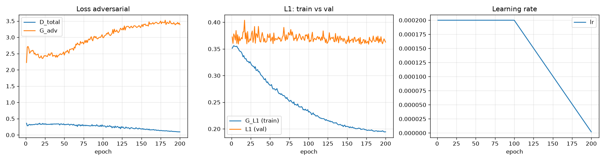
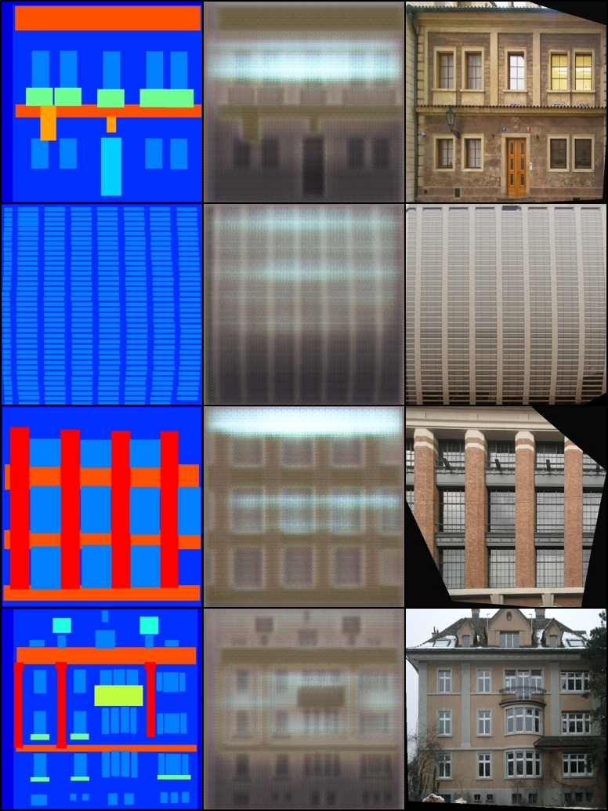
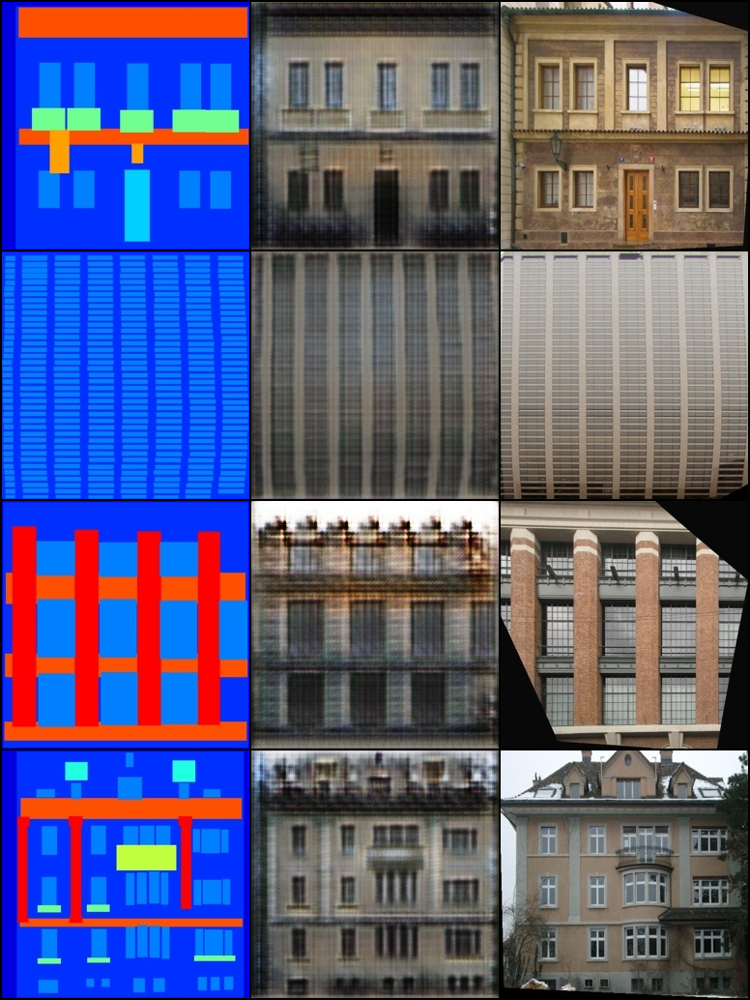
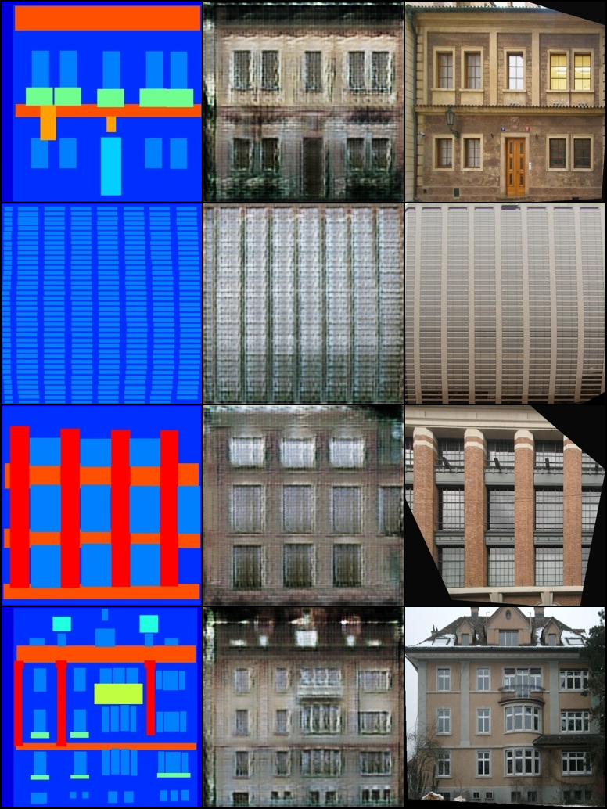
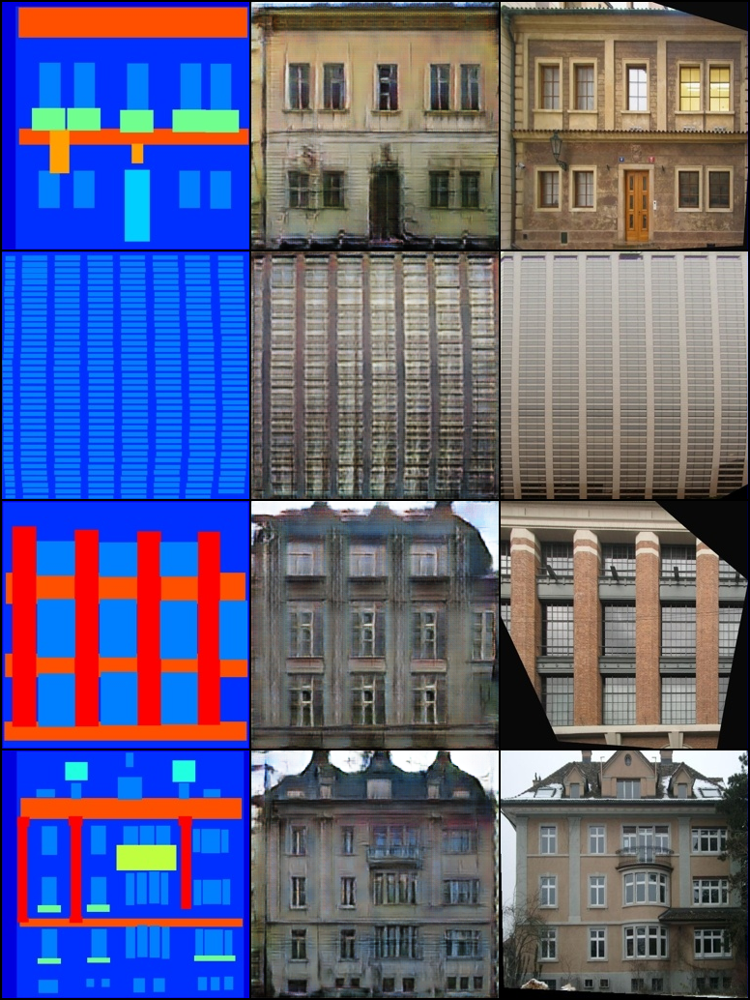
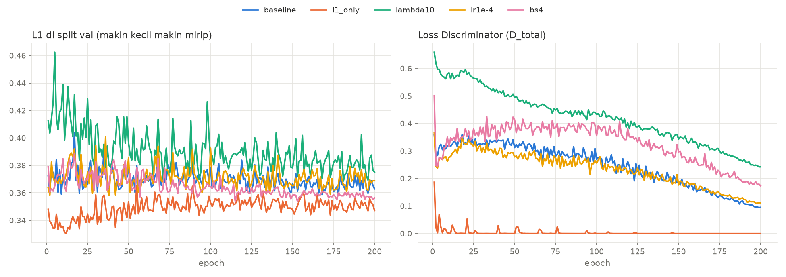
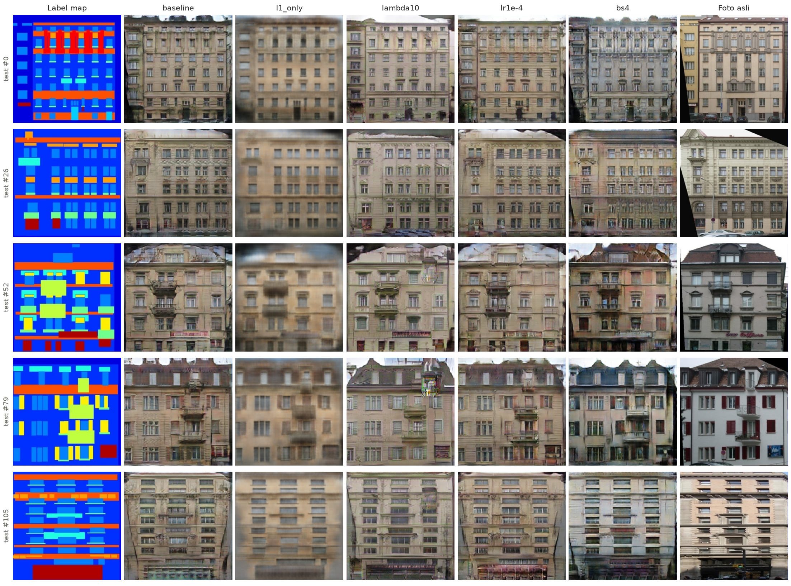

# Draf Bagian Model, Training, Hasil & Analisis

Bahan dari Zafira untuk laporan, mengisi bagian **3.3, 3.4, 4.1–4.4** di `kerangka_laporan.md`.

> Catatan untuk Ce (hapus sebelum dikumpulkan):
> - Ini draf. Silakan parafrasekan pakai gaya bahasa laporan, jangan ditempel mentah.
> - Semua angka diambil dari `docs/hasil/results_table.csv` (hasil `evaluate.py` di split test).
> - Penanda `[BAHAN: Zafira]` = gambar/angka yang masih harus aku ambil dari PC.

---

## 3.3 Arsitektur Model

**Generator: U-Net** (`src/models/generator.py`), 54.414.531 parameter.

- Encoder 8 blok downsampling: Conv 4×4 stride 2 → BatchNorm → LeakyReLU(0,2). Ukuran spasial turun 256 → 128 → … → 1. Jumlah channel 64, 128, 256, 512, 512, 512, 512, 512.
- Blok encoder pertama dan bottleneck (1×1) tidak memakai BatchNorm.
- Decoder 7 blok upsampling: ConvTranspose 4×4 stride 2 → BatchNorm → (Dropout 0,5 di 3 blok pertama) → ReLU. Output tiap blok digabung (*concat*) dengan output encoder yang ukurannya sama (*skip connection*).
- Lapisan akhir ConvTranspose ke 3 channel + Tanh, sehingga output berada di rentang [-1, 1], sama dengan rentang data.

Skip connection penting untuk tugas ini karena struktur gambar input (posisi jendela, pintu, balkon) harus muncul di posisi yang sama pada output. Tanpa skip connection, informasi posisi itu harus melewati bottleneck berukuran 1×1 dan banyak yang hilang.

**Discriminator: PatchGAN 70×70** (`src/models/discriminator.py`), 2.768.705 parameter.

- Input: label map dan gambar (asli atau palsu) digabung jadi 6 channel.
- 4 blok Conv 4×4 (stride 2, 2, 2, 1) dengan channel 64 → 128 → 256 → 512, lalu Conv akhir ke 1 channel. Blok pertama tanpa BatchNorm.
- Output berupa grid 30×30 logits. Tiap nilai menilai asli/palsu untuk satu potongan (*patch*) gambar berukuran sekitar 70×70 piksel.
- Tidak ada sigmoid di akhir, karena sigmoid sudah termasuk di dalam `BCEWithLogitsLoss`.

Dengan menilai per patch, D fokus pada tekstur dan detail lokal (tepi jendela, pola bata). Struktur global sudah dijaga oleh loss L1.

**Inisialisasi bobot:** Conv dan ConvTranspose ~ Normal(0; 0,02), BatchNorm ~ Normal(1; 0,02), bias = 0.

---

## 3.4 Fungsi Loss dan Training

**Loss** (`src/losses.py`):

- Discriminator: `L_D = 0,5 × [BCE(D(x, y), 1) + BCE(D(x, G(x)), 0)]`. Faktor 0,5 memperlambat D supaya tidak terlalu cepat mengalahkan G.
- Generator: `L_G = λ_adv × BCE(D(x, G(x)), 1) + λ_L1 × |G(x) − y|`, dengan λ_adv = 1 dan λ_L1 = 100.
- Peran masing-masing: suku adversarial membuat hasil tampak seperti foto asli (tajam), sedangkan L1 menjaga hasil tetap dekat dengan target (struktur dan warna secara umum).

**Urutan satu iterasi** (`src/train.py`):

1. G membuat gambar palsu dari label map.
2. Update D dengan pasangan asli dan pasangan palsu. Gambar palsu di-`detach()` supaya gradien D tidak mengalir ke G.
3. Bekukan D, lalu update G memakai penilaian D dan loss L1.

**Hyperparameter baseline:**

| Hyperparameter | Nilai |
|---|---|
| Optimizer | Adam, β1 = 0,5, β2 = 0,999 |
| Learning rate | 2×10⁻⁴, konstan sampai epoch 100, lalu turun linear menuju 0 sampai epoch 200 |
| Batch size | 1 |
| λ_L1 / λ_adv | 100 / 1 |
| Epoch | 200 (400 iterasi per epoch, total 80.000 iterasi) |
| Seed | 42 |

**Checkpoint dan resume:** `last.pt` disimpan tiap epoch dan berisi semua yang dibutuhkan untuk melanjutkan training persis (bobot, state optimizer, scheduler, posisi random number generator). Penyimpanan dibuat atomik (tulis ke file sementara, lalu rename), jadi kalau PC mati saat menyimpan, checkpoint lama tetap utuh. `best.pt` (val L1 terendah) dan `epoch_050/100/150/200.pt` hanya berisi bobot, untuk evaluasi.

**Metrik selama training:** setiap epoch dihitung L1 di split val (`val_L1`). Loss GAN naik-turun dan sulit dibaca, jadi val_L1 dipakai sebagai indikator yang lebih stabil.

---

## 4.1 Hasil Training Baseline

**Perkembangan hasil selama training** (run `bs4`, 4 gambar val yang sama di setiap epoch; tiap baris: label map | hasil G | foto asli):

| Epoch 1 | Epoch 10 | Epoch 50 | Epoch 200 |
|---|---|---|---|
|  |  |  |  |

- **Epoch 1:** hasil masih berupa bayangan abu-abu buram. Posisi lantai dan jendela baru terlihat samar.
- **Epoch 10:** struktur bangunan sudah jelas (baris jendela, garis lantai), tapi warnanya gelap dan masih banyak bercak.
- **Epoch 50:** tekstur mulai muncul (kusen, bata, ornamen), tapi masih kasar dan ada noise kehijauan.
- **Epoch 200:** hasil paling bersih, warna dinding lebih masuk akal, dan detail jendela lebih rapi. Penurunan learning rate di epoch 101–200 membantu menghaluskan hasil.

Pengamatan:

- Training stabil sampai epoch 200, tanpa *mode collapse* (G tidak menghasilkan gambar yang sama untuk semua input) dan tanpa loss meledak.
- **val_L1 sudah hampir datar sejak sekitar epoch 25** (berkisar 0,36–0,38). Setelah itu, peningkatan kualitas terlihat pada ketajaman dan detail gambar, bukan pada L1.
- **D_total terus turun, terutama setelah epoch 100** ketika learning rate mulai diturunkan, sampai sekitar 0,10 di akhir. Artinya D makin unggul atas G di akhir training. Ini umum terjadi pada Pix2Pix dengan dataset kecil, dan hasil visualnya tetap baik.
- Waktu training sekitar 39 menit (sekitar 12 detik per epoch) di RTX 5060 Ti.

---

## 4.2 Eksperimen Tuning

Lima run dengan konfigurasi yang sama kecuali satu hyperparameter yang diubah (200 epoch, seed 42). Evaluasi memakai checkpoint epoch terakhir di split **test (106 gambar)**.

| Run | Yang diubah | L1 ↓ | PSNR (dB) ↑ | SSIM ↑ | Ketajaman* | D_total akhir | Waktu (menit) |
|---|---|---|---|---|---|---|---|
| `baseline` | – | 0,3699 | 12,59 | 0,2251 | 0,513 | 0,096 | 39 |
| `l1_only` | λ_adv = 0 | **0,3576** | **12,95** | **0,3178** | 0,039 | 0,000 | 38 |
| `lambda10` | λ_L1 = 10 | 0,3768 | 12,43 | 0,2230 | 0,501 | 0,243 | 39 |
| `lr1e-4` | lr = 1×10⁻⁴ | 0,3736 | 12,49 | 0,2281 | 0,477 | 0,110 | 38 |
| `bs4` | batch size = 4 | 0,3619 | 12,55 | 0,2470 | **0,569** | 0,173 | **16** |

\* Ketajaman = rasio *variance of Laplacian* gambar hasil terhadap foto asli. Nilai 1 berarti setajam foto asli, jauh di bawah 1 berarti blur.

**Analisis per eksperimen:**

**`l1_only` (tanpa loss adversarial).** Unggul di semua metrik kemiripan (L1, PSNR, SSIM), tapi ketajamannya hanya 0,039, sekitar 13× lebih buram dari run lain. Tanpa Discriminator, G belajar menghasilkan "rata-rata" dari semua kemungkinan foto, yang aman untuk L1 tapi buram. D_total langsung turun ke 0 karena D tetap dilatih, sementara G tidak pernah berusaha menipunya. Grafik val_L1 juga menunjukkan sedikit overfitting: nilai terendah sekitar 0,33 di epoch 10–15, lalu naik ke sekitar 0,35.

Hasil ini menunjukkan dua hal:
1. Loss adversarial adalah komponen yang membuat hasil Pix2Pix tajam, sesuai klaim paper Isola dkk. (2017).
2. L1, PSNR, dan SSIM saja tidak cukup untuk menilai model generatif. Model yang hasilnya paling buram justru mendapat skor terbaik.

**`lambda10` (bobot L1 diturunkan dari 100 ke 10).** Detail paling banyak, tapi artefak warna juga paling banyak (bercak warna-warni yang tidak ada hubungannya dengan label map). Dengan bobot L1 kecil, G lebih bebas mengikuti D dan lebih sering "mengarang". Metrik kemiripannya terburuk, D_total paling tinggi, dan val_L1 paling berfluktuasi.

**`lr1e-4` (learning rate setengah dari baseline).** Hasil mirip baseline dengan detail sedikit lebih sedikit, dan semua metrik sedikit lebih buruk. Dengan jumlah epoch yang sama, learning rate yang lebih kecil membuat model belajar lebih lambat.

**`bs4` (batch size 4).** Run GAN terbaik: L1, SSIM, dan ketajaman terbaik di antara run yang memakai loss adversarial. Secara visual paling bersih dan warnanya lebih bervariasi. Training 2,4× lebih cepat karena GPU memproses 4 gambar sekaligus. Menariknya, jumlah update hanya 20.000 (seperempat dari baseline) tapi hasilnya justru lebih baik. Kemungkinan karena gradien dan statistik BatchNorm yang dihitung dari 4 gambar lebih stabil dibanding dari 1 gambar.

**Kesimpulan tuning:** konfigurasi terbaik adalah **`bs4`**.

**Keterbatasan:** setiap konfigurasi hanya dijalankan dengan satu seed, dan selisih metrik antar run GAN kecil (L1 0,362–0,377). Sebagian selisih ini bisa disebabkan faktor acak. Untuk kesimpulan yang lebih kuat, setiap konfigurasi perlu dijalankan dengan beberapa seed.

---

## 4.3 Hasil Visual

Kolom: label map | baseline | l1_only | lambda10 | lr1e-4 | bs4 | foto asli.

Pengamatan:

- **Semua run berhasil mengikuti struktur label map.** Posisi jendela, balkon, pintu, dan lantai sesuai dengan input.
- **`l1_only`** buram seperti foto yang tidak fokus, dengan warna cokelat rata.
- **Run dengan GAN** menghasilkan tekstur yang meyakinkan (ornamen, kusen jendela, bata), meskipun detailnya tidak sama dengan foto asli.
- **Warna hasil berbeda dari foto asli.** Ini bukan kesalahan model: label map tidak berisi informasi warna, sehingga satu label map bisa cocok dengan banyak foto yang sama-sama masuk akal (gedung krem, abu, atau putih). Hal ini juga menjelaskan kenapa PSNR rendah (sekitar 12–13 dB): L1 dan PSNR menghukum warna yang masuk akal tapi berbeda dari foto asli.
- **Kegagalan yang sering muncul:** bercak putih/abu di area langit bagian atas gambar (baseline, lr1e-4), artefak warna-warni (lambda10, contoh test #52 dan #79), dan garis vertikal (bs4, test #79). Area langit dan tepi gambar paling sering gagal karena di label map area tersebut hanya berupa latar belakang tanpa struktur.

[BAHAN: Zafira, contoh hasil terbaik dan terburuk dari `outputs/bs4/eval/test_last_eval/per_image.csv` (urutkan kolom L1)]

---

## 4.4 Evaluasi Kuantitatif

Semua metrik dihitung dengan kode sendiri di `src/metrics.py` (tanpa library tambahan), untuk 106 gambar test:

| Metrik | Skala | Arti |
|---|---|---|
| L1 | piksel [-1, 1] | rata-rata selisih absolut piksel, sama dengan val_L1 di training |
| PSNR | piksel [0, 1], dB | 10·log10(1 / MSE); makin tinggi makin mirip |
| SSIM | [0, 1] | kemiripan struktur lokal (kecerahan, kontras, struktur) dengan jendela Gaussian 11×11 |
| Ketajaman | rasio | *variance of Laplacian* hasil ÷ foto asli; mengukur blur |

Metrik dibagi dua kelompok yang harus dibaca bersama:

1. **Kemiripan dengan foto asli (L1, PSNR, SSIM).** Model yang "main aman" dengan hasil buram cenderung unggul di sini.
2. **Ketajaman.** Menangkap blur yang tidak terlihat di metrik kemiripan.

Kasus `l1_only` membuktikan pentingnya membaca keduanya bersama: skor kemiripannya terbaik, tapi ketajamannya terburuk.

Sebagai pembanding, PSNR sekitar 12–13 dB dan SSIM sekitar 0,22–0,32 adalah kisaran yang wajar untuk dataset Facades. Dataset ini memang sulit karena hubungan label map → foto bersifat satu-ke-banyak.
