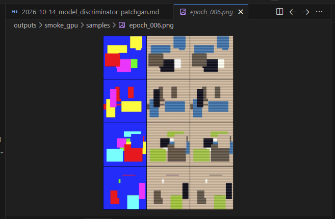
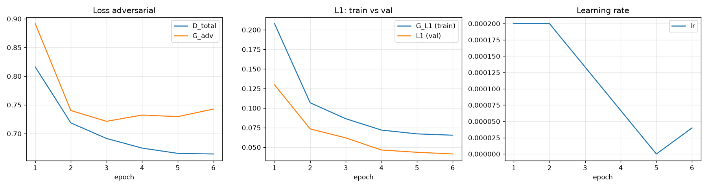

# LOG INTERAKSI LLM - KELOMPOK 9

- **Tanggal Sesi:** 15–16/10/2026
- **Anggota:** Zafira (Model & Training)
- **Target Modul:** Training loop — `src/train.py`, `src/config.py`, `src/utils.py`, `src/dummy_dataset.py`
- **LLM:** Claude (claude.ai, proyek "Pix2Pix Gen AI")
- **Tautan Sesi Chat:** https://claude.ai/share/76a63b11-5388-4948-939c-83bc384ed692

---

## KRONOLOGI PROMPT & RESPONS

### 1. TAHAP INISIASI (Alur Training & Kode Awal)

- **Prompt:**
  > Model (UNetGenerator, PatchGANDiscriminator, init_weights) dan losses.py (Pix2PixLoss) sudah selesai dan lolos smoke test di PC. [hasil `py -m src.losses` dan tes GPU x@x] Dataset Facades sudah aku download ke `data/facades/` di PC (train 400, val 100, test 106). Sisi kiri = foto, sisi kanan = label map. dataset.py sedang dikerjakan Fira.
  >
  > Sekarang aku mau bikin training loop di `src/train.py`, sesuai KONTRAK.md dan config.py v1.2 di Konteks. Sebelum nulis kode, jelaskan dulu alur satu iterasi training Pix2Pix: urutan update D dan G, kapan pakai detach, dan apa saja yang perlu disimpan (checkpoint, sampel gambar, log loss) supaya training bisa di-resume. Sekalian sesuaikan config.py (num_workers, pin_memory, persistent_workers, lambda_adv). Siapkan juga cara ngetes train.py pakai data dummy sampai dataset.py dari Fira masuk.

- **Alasan Khusus:** Training loop adalah bagian inti tugasku dan paling rawan bug. Aku minta alurnya dijelaskan dulu supaya paham kenapa D di-update duluan dan kapan pakai `detach`. Karena `dataset.py` belum jadi, aku minta mode data dummy supaya `train.py` bisa dites tanpa menunggu Fira.

- **Output Model (ringkasan):**
  - **Alur satu iterasi:**
    1. `fake_B = G(real_A)`, dihitung sekali.
    2. **Update D duluan:** `D(real_A, real_B)` → label 1, `D(real_A, fake_B.detach())` → label 0. `detach()` supaya gradien tidak mengalir ke G (kalau tidak, muncul error `Trying to backward through the graph a second time`).
    3. **Update G:** D dibekukan (`set_requires_grad(D, False)`), lalu `D(real_A, fake_B)` **tanpa detach** dengan label 1, ditambah L1 × 100. D dipanggil ulang karena bobotnya baru saja di-update.
  - **Yang disimpan supaya bisa resume:** bobot G dan D, state optimizer Adam (momentum), state scheduler, nomor epoch, best val_L1, RNG state (Python, NumPy, torch, CUDA) + generator shuffle, dan config.
  - **Output di `outputs/<run_name>/`:** `checkpoints/` (`last.pt`, `best.pt`, `epoch_XXX.pt`), `samples/epoch_XXX.png` (grid label | hasil G | foto asli), `logs/losses.csv` dan `logs/loss_curve.png`.
  - **`train.py`:** semua field config otomatis jadi argumen terminal (`--lr`, `--run_name`, dst.), jadwal lr konstan 100 epoch lalu turun linear 100 epoch (sesuai paper), dan otomatis resume kalau `last.pt` ada. Ditambah **val_L1** sebagai angka utama untuk membandingkan eksperimen tuning, karena loss GAN naik-turun.
  - **`config.py`** diganti jadi dataclass `TrainConfig`: `num_workers=4`, `pin_memory=True`, `persistent_workers=True`, `lambda_adv=1.0`, `lambda_l1=100`.
  - **`utils.py`:** checkpoint disimpan atomik (tulis ke `.tmp` lalu rename), CSV logger yang membuang baris dobel setelah resume, grid sampel, dan grafik loss.
  - **`dummy_dataset.py`:** kotak-kotak warna sebagai input, target berupa fungsi pasti dari input, sehingga **L1 harus turun** kalau loop-nya benar.
  - Claude sempat menemukan bug sendiri saat tes di sisinya: hasil setelah resume beda tipis dari run tanpa henti, karena `DataLoader(shuffle=True)` mengambil angka acak tambahan saat iterator dibuat. Solusinya, shuffle dipindah ke `RandomSampler` dengan generator sendiri.

- **Catatan integrasi:** Claude bertanya apakah nama method di `losses.py` sesuai. Sudah dicek: `discriminator_loss(pred_real, pred_fake)`, `generator_loss(pred_fake, fake, target)`, dan `Pix2PixLoss(lambda_adv=, lambda_l1=)` cocok, tidak ada yang perlu diganti.

### 2. TAHAP PENANGANAN EROR / DEBUGGING

- **Pesan Eror (tes pertama di PC, GPU):**
  ```
  PS> py -m src.train --dummy --run_name smoke --epochs 3 --decay_start_epoch 2
  [info] run=smoke device=cuda dummy=True
  [info] GPU: NVIDIA GeForce RTX 5060 Ti
  [info] train=40 val=8 | 40 iterasi/epoch
  Traceback (most recent call last):
    File "src\train.py", line 234, in main
      save_samples(G, fixed_batch, sample_dir / f"epoch_{epoch:03d}.png", device)
    File "src\train.py", line 138, in save_samples
      save_sample_grid(real_A, fake_B, fixed_batch["target"], path)
    File "src\utils.py", line 72, in save_sample_grid
      grid = denorm(torch.stack(rows).cpu())
  RuntimeError: Expected all tensors to be on the same device, but got tensors is on cpu, different from other tensors on cuda:0 (when checking argument in method wrapper_CUDA_cat)
  ```

- **Prompt Perbaikan ke LLM:**
  > Di PC (GPU) muncul error waktu nyimpen sampel di epoch 1: [traceback di atas]. Kenapa ini nggak ketahuan waktu kamu tes? Tolong perbaiki.

- **Alasan Khusus:** Aku tanya kenapa tidak ketahuan, bukan cuma minta diperbaiki, supaya paham kenapa tes Claude sebelumnya lolos tapi di PC gagal.

- **Analisis LLM:**
  - `real_A` dan `fake_B` sudah dipindah ke GPU di `save_samples`, tapi `fixed_batch["target"]` masih di CPU. `torch.stack` menolak menggabungkan tensor dari device berbeda. `.cpu()` di `utils.py` posisinya setelah `stack`, jadi terlambat.
  - Tidak ketahuan karena workspace Claude **tidak punya GPU**: semua tensor otomatis di CPU, jadi device mismatch tidak mungkin terjadi.
  - Claude lalu menyisir ulang semua jalur yang hanya jalan di GPU dan menemukan **bug kedua** yang belum sempat kena: `load_checkpoint` memakai `map_location=device`, sehingga RNG state ikut pindah ke GPU. Padahal `torch.set_rng_state` hanya menerima tensor CPU, jadi resume pertama pasti crash (`TypeError: RNG state must be a torch.ByteTensor`).

- **Solusi:**
  1. `save_sample_grid`: ketiga tensor dipindah ke CPU **sebelum** `torch.stack`.
  2. `load_checkpoint`: selalu `map_location="cpu"`. Bobot model dan state optimizer tetap berakhir di GPU, karena `load_state_dict()` menyalin ke device tempat model berada.
  3. Pemanggilan di `train.py` disesuaikan jadi `load_checkpoint(last_path)`.

- **Analisis & Pelajaran Kelompok:** Bug device mismatch hanya muncul kalau ada lebih dari satu device (CPU + GPU). Smoke test di CPU tidak cukup, jadi **dummy run singkat di GPU wajib dijalankan sebelum training 200 epoch**. Untungnya bug kedua ketemu sebelum training panjang. Kalau tidak, training 200 epoch yang terputus tidak akan bisa dilanjutkan.

### 3. TAHAP VERIFIKASI (Dummy Run di GPU)

- **Perintah & hasil:**
  ```
  PS> py -m src.train --dummy --run_name smoke_gpu --epochs 4 --decay_start_epoch 2
  [info] run=smoke_gpu device=cuda dummy=True
  [info] GPU: NVIDIA GeForce RTX 5060 Ti
  [info] train=40 val=8 | 40 iterasi/epoch
  [epoch   1/4] D=0.8162 G_adv=0.8917 G_L1=0.2080 val_L1=0.1298 lr=2.00e-04 (26.8s)
  [epoch   2/4] D=0.7187 G_adv=0.7403 G_L1=0.1068 val_L1=0.0735 lr=2.00e-04 (1.2s)
  [epoch   3/4] D=0.6916 G_adv=0.7215 G_L1=0.0864 val_L1=0.0620 lr=1.33e-04 (1.2s)
  [epoch   4/4] D=0.6748 G_adv=0.7324 G_L1=0.0720 val_L1=0.0465 lr=6.67e-05 (1.3s)
  [selesai] best val_L1=0.0465 | output di outputs\smoke_gpu
  ```

- **Analisis Kelompok:**
  - `G_L1` dan `val_L1` turun terus, jadi training loop benar dan G benar-benar belajar.
  - lr konstan sampai epoch 2, lalu turun linear, sesuai `--decay_start_epoch 2`.
  - `D_total` dan `G_adv` sekitar 0,7, dekat patokan ln 2 ≈ 0,693 dari sesi losses, artinya G dan D seimbang.
  - Epoch 1 butuh 26,8 detik, epoch berikutnya 1,2 detik. Epoch pertama berisi pemanasan GPU (cuDNN memilih algoritma konvolusi tercepat) dan start worker DataLoader di Windows.

### 4. TAHAP VERIFIKASI RESUME

- **Perintah & hasil** (run yang sama dilanjutkan dengan `--epochs 6`):
  ```
  PS> py -m src.train --dummy --run_name smoke_gpu --epochs 6 --decay_start_epoch 2
  [info] run=smoke_gpu device=cuda dummy=True
  [info] GPU: NVIDIA GeForce RTX 5060 Ti
  [info] train=40 val=8 | 40 iterasi/epoch
  [resume] lanjut dari epoch 5 (best val_L1=0.0465)
  [warn] config sekarang beda dengan config di checkpoint. Kalau ini eksperimen baru, pakai --run_name lain.
  [epoch   5/6] D=0.6656 G_adv=0.7296 G_L1=0.0671 val_L1=0.0435 lr=0.00e+00 (26.2s)
  [epoch   6/6] D=0.6645 G_adv=0.7428 G_L1=0.0654 val_L1=0.0414 lr=4.00e-05 (1.4s)
  [selesai] best val_L1=0.0414 | output di outputs\smoke_gpu
  ```

- **Analisis Kelompok:**
  - Resume berhasil: checkpoint dimuat tanpa error di GPU (bug kedua sudah benar-benar teratasi), training lanjut dari epoch 5, dan `val_L1` terus turun sampai 0,0414.
  - `lr = 0` di epoch 5 **bukan bug**, tapi akibat mengubah `--epochs` dari 4 ke 6 di tengah run. Dengan jadwal 4 epoch, lr sudah turun ke 0 setelah epoch 4, dan nilai itu tersimpan di state optimizer. Jadwal 6 epoch baru berlaku setelah `scheduler.step()` di akhir epoch 5. Karena itulah `train.py` memunculkan peringatan `[warn]`.
  - **Aturan yang diambil:** saat resume, config tidak boleh diubah. Kalau mau eksperimen dengan setting berbeda, pakai `--run_name` baru.

- **Bukti visual:**
  - Sampel epoch 6 (kolom: label | hasil G | target). Hasil G sudah hampir sama dengan target, termasuk pola garis-garisnya:

    

  - Grafik loss (kiri: adversarial, tengah: L1 train vs val, kanan: learning rate). Lonjakan lr di epoch 5–6 adalah efek perubahan `--epochs` yang dijelaskan di atas:

    

---

**Status:** `train.py` siap dipakai untuk training dengan dataset asli setelah `dataset.py` dari Fira di-merge.

**Commit terkait (branch `feat/training`):**
- `feat(training): ganti config.py jadi TrainConfig untuk PC lokal`
- `feat(training): tambah utils untuk seed, checkpoint, log CSV, dan sampel`
- `feat(training): tambah dummy dataset untuk tes train.py`
- `feat(training): tambah training loop dengan resume dan val_L1`
- `fix(training): perbaiki device mismatch di sampel dan load checkpoint ke CPU`
